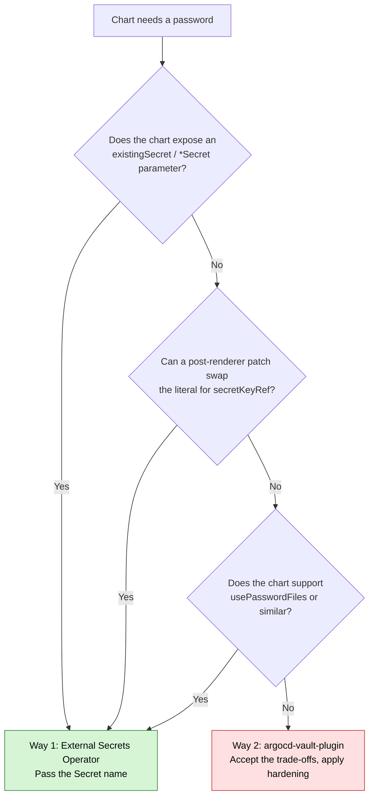

# Secret Management with Argo CD and OpenBao — Overview

This repository documents how to deliver secrets to applications deployed by Argo CD,
using [OpenBao](https://openbao.org/) as the secret store.

Upstream reference: [Argo CD — Secret Management](https://argo-cd.readthedocs.io/en/stable/operator-manual/secret-management/)

## The two ways

Argo CD's documentation describes exactly two places a secret can be populated. The
difference between them comes down to a single question: **who calls OpenBao?**

| | Way 1 — Destination cluster | Way 2 — Manifest generation |
|---|---|---|
| Who calls OpenBao | An operator in the target cluster | Argo CD's repo-server |
| What is in Git | A *reference* (`ExternalSecret`) | A *placeholder* (`<path:...>`) |
| Does Argo CD see the value | No | **Yes** |
| Typical tooling | External Secrets Operator, Vault Agent Injector, Secrets Store CSI Driver | `argocd-vault-plugin` |
| Upstream stance | **Strongly recommended** | **Strongly cautioned against**, still supported |

Both keep plaintext secrets out of Git. That is not the differentiator, and it is the most
common misconception. The differentiator is whether the secret value passes *through* Argo CD.

## Where the secret exists, per way

| Location | Way 1 | Way 2 |
|---|---|---|
| Git | No | No |
| `Application` resource | No | No |
| Argo CD Redis cache | No | **Yes, plaintext** |
| repo-server gRPC API | No | **Yes** |
| Argo CD UI / `argocd app manifests` | No | **Yes** |
| `Secret` in destination cluster | Yes | Yes |

The three "Yes" cells in the Way 2 column are the entire reason upstream cautions against it.

## Decision rule

The choice is **per chart**, not per platform. Ask one question: can the secret value land
in a Kubernetes `Secret` that the workload reads by name?



Check any chart in one command:

```bash
helm show values bitnami/redis | grep -i -E 'existingsecret|secretkey|usersecret|passwordfiles'
```

A hit means Way 1. No output means work down the diagram toward Way 2.

## Worked classification of the Redis example

The Bitnami Redis chart is a useful case because it *looks* like a Way 2 problem and is not.

```yaml
## values.yaml — the plaintext trap
auth:
  acl:
    users:
      - username: "my-user"
        password: "mypassword"   # <-- plaintext in Git and in the Argo CD UI
```

The same chart provides the escape hatch a few lines below:

```yaml
## @param auth.acl.userSecret Name of the Secret, containing user credentials for ACL users.
##                            Keys must match usernames.
userSecret: ""
```

Plus `auth.existingSecret` and `auth.existingSecretPasswordKey` for the non-ACL password.
So Redis is **Way 1**. See [`examples/redis-eso/`](../examples/redis-eso/).

## A note on the Argo CD GUI

Helm parameters typed into the Argo CD web UI are persisted into the live `Application`
resource. That means:

- plaintext in etcd,
- readable by anyone holding `applications, get` on the project,
- permanent drift against Git if you manage `Application`s declaratively.

Never type a password into the GUI parameters box, under either way.

## Documents in this repository

| Document | Contents |
|---|---|
| [`02-manifest-generation-openbao.md`](02-manifest-generation-openbao.md) | Way 2: full flow and technical implementation with `argocd-vault-plugin` + OpenBao |
| [`03-destination-cluster-eso.md`](03-destination-cluster-eso.md) | Way 1: reference implementation with External Secrets Operator + OpenBao |
| [`04-argocd-own-secrets.md`](04-argocd-own-secrets.md) | Argo CD's *own* secrets (repo credentials, clusters, SSO) from OpenBao |
