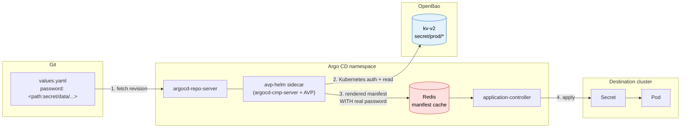

# Way 2 — Argo CD Manifest Generation-Based Secret Management with OpenBao

This is the implementation guide for the case where a Helm chart accepts a password **only
as a literal value** and offers no `existingSecret`-style parameter. Argo CD resolves a
placeholder from OpenBao while rendering the manifest.

> **Before implementing this**, confirm the chart really belongs here using the decision
> rule in [`01-overview.md`](01-overview.md). Upstream strongly cautions against this
> approach, and the maintainers have stated they will not prioritise new features for it.
> Keep the set of applications using this path as small as possible, and document each one.

## 1. What changes structurally

Today, with Vault Agent Injector and the CSI driver, OpenBao trust lives in the destination
cluster. Argo CD holds no OpenBao credentials at all.

This approach changes that: **`argocd-repo-server` becomes an OpenBao client.** That single
fact drives every security consideration below.

## 2. Architecture



The red node is the risk: rendered manifests, secrets included, are cached in plaintext and
are also reachable through the repo-server gRPC API.

## 3. Request flow, step by step

```mermaid
sequenceDiagram
    autonumber
    participant U as User / Git push
    participant C as application-controller
    participant R as repo-server
    participant P as AVP sidecar
    participant B as OpenBao
    participant D as Destination cluster

    U->>C: New revision (or sync / hard refresh)
    C->>R: GenerateManifest(repo, revision, plugin)
    R->>P: Send repo contents over CMP socket
    P->>P: helm dependency build
    P->>P: helm template  → manifests with &lt;path:...&gt;
    P->>B: Login via Kubernetes auth (repo-server ServiceAccount JWT)
    B-->>P: Short-lived token (policy: argocd-avp-read)
    P->>B: Read secret/data/prod/legacy-app
    B-->>P: {"password": "s3cr3t"}
    P->>P: Substitute placeholder with real value
    P-->>R: Rendered manifests (contain the secret)
    R-->>C: Manifests (cached in Redis, plaintext)
    C->>D: kubectl apply → Secret created
    D->>D: Pod consumes Secret
```

## 4. Prerequisites

| Requirement | Notes |
|---|---|
| Argo CD ≥ 2.6 | Sidecar config management plugins (`spec.source.plugin.name`) |
| OpenBao reachable from `argocd` namespace | Network path from repo-server to OpenBao |
| OpenBao `kv-v2` engine | Mounted at `secret/` in these examples |
| OpenBao Kubernetes auth | Must trust the cluster Argo CD runs in |
| Container registry | For the custom sidecar image in [`avp/Dockerfile`](../avp/Dockerfile) |

If Argo CD and OpenBao are in **different** clusters, Kubernetes auth must be configured for
Argo CD's cluster specifically (issuer, CA, and JWT reviewer). Kubernetes auth validates the
ServiceAccount token against the cluster that issued it — a role configured for your
workload cluster will not authenticate the repo-server in the Argo CD cluster.

## 5. Implementation

### 5.1 Configure OpenBao

Grant read-only access to exactly the paths Argo CD needs. Policy in
[`openbao/policy-argocd-avp.hcl`](../openbao/policy-argocd-avp.hcl):

```hcl
path "secret/data/prod/*" {
  capabilities = ["read"]
}

path "secret/metadata/prod/*" {
  capabilities = ["read", "list"]
}
```

Bind it to the repo-server ServiceAccount — run
[`openbao/setup-kubernetes-auth.sh`](../openbao/setup-kubernetes-auth.sh) or the equivalent:

```bash
bao policy write argocd-avp-read openbao/policy-argocd-avp.hcl

bao write auth/kubernetes/role/argocd-repo-server \
    bound_service_account_names=argocd-repo-server \
    bound_service_account_namespaces=argocd \
    token_policies=argocd-avp-read \
    token_ttl=1h \
    audience=openbao
```

Scope the policy to the narrowest path prefix that works. This policy is the only thing
standing between a compromised repo-server and your secret store.

### 5.2 Build the sidecar image

The sidecar needs `helm` and `argocd-vault-plugin`. It does **not** need `argocd-cmp-server`
baked in — the repo-server's existing `copyutil` init container shares that binary through
the `var-files` volume.

```bash
docker build -t registry.example.com/argocd-vault-plugin:1.18.1 avp/
docker push  registry.example.com/argocd-vault-plugin:1.18.1
```

### 5.3 Register the plugin

[`avp/plugin-configmap.yaml`](../avp/plugin-configmap.yaml) defines two plugins:
`argocd-vault-plugin-helm` for charts, and `argocd-vault-plugin` for plain
directories/kustomize.

The Helm variant's `generate` command is the important part:

```yaml
generate:
  command:
    - bash
    - "-c"
    - |
      set -o pipefail
      if [ -f Chart.lock ] || grep -q '^dependencies:' Chart.yaml 2>/dev/null; then
        helm dependency build >/dev/null 2>&1 || helm dependency update >/dev/null
      fi
      helm template "$ARGOCD_APP_NAME" \
        --namespace "$ARGOCD_APP_NAMESPACE" \
        --include-crds \
        ${ARGOCD_ENV_HELM_ARGS} . \
      | argocd-vault-plugin generate -
```

`helm template` renders the chart with placeholders still in place; `argocd-vault-plugin
generate -` then substitutes them.

Two details in that command exist for real failure modes:

- **`set -o pipefail`** — without it, a failing `helm template` still exits 0 because
  `argocd-vault-plugin` succeeds on empty input, and Argo CD would silently prune resources
  it believes were removed from the chart.
- **The `dependency build || update` fallback** — `helm dependency build` refuses to resolve a
  classic HTTP chart repository that was never registered with `helm repo add`, and this
  sidecar has no Helm repository config. Referencing dependencies by OCI
  (`oci://registry-1.docker.io/bitnamicharts`) avoids the problem entirely and keeps
  `Chart.lock` authoritative; the `update` fallback covers charts that still use HTTP URLs.

### 5.4 Patch the repo-server

Apply [`avp/`](../avp/) with Kustomize, or merge
[`avp/repo-server-patch.yaml`](../avp/repo-server-patch.yaml) into your Argo CD
installation. It adds the sidecar, the plugin ConfigMap mounts, and the OpenBao environment:

```yaml
env:
  - name: AVP_TYPE
    value: vault
  - name: AVP_AUTH_TYPE
    value: k8s
  - name: AVP_K8S_ROLE
    value: argocd-repo-server
  - name: AVP_K8S_MOUNT_PATH
    value: auth/kubernetes
  - name: AVP_KV_VERSION
    value: "2"
  - name: VAULT_ADDR
    value: https://openbao.openbao.svc.cluster.local:8200
```

No token is stored anywhere: AVP reads the projected ServiceAccount JWT from
`/var/run/secrets/kubernetes.io/serviceaccount/token` and exchanges it for a short-lived
OpenBao token on each render.

### 5.5 Write placeholders in Git

For `kv-v2`, the read path includes the `data/` segment — a very common mistake:

```yaml
# correct for kv-v2 mounted at secret/
password: <path:secret/data/prod/legacy-app#password>

# wrong — this is the KV v1 form and returns a 403/404 against kv-v2
password: <path:secret/prod/legacy-app#password>
```

Full example: [`examples/legacy-app-avp/`](../examples/legacy-app-avp/).

### 5.6 Point the Application at the plugin

```yaml
spec:
  source:
    repoURL: https://github.com/myorg/SM_Argocd.git
    targetRevision: main
    path: examples/legacy-app-avp/chart
    plugin:
      name: argocd-vault-plugin-helm
      env:
        - name: HELM_ARGS
          value: "-f values.yaml"
```

Plugin `env` entries are exposed to the plugin prefixed with `ARGOCD_ENV_`, which is why the
generate command reads `$ARGOCD_ENV_HELM_ARGS`. Never put a secret in this `env` block — it
is stored in the `Application` resource in plaintext.

## 6. Verification

```bash
# 1. Sidecar is up
kubectl -n argocd get deploy argocd-repo-server \
  -o jsonpath='{.spec.template.spec.containers[*].name}'

# 2. AVP can authenticate to OpenBao
kubectl -n argocd exec deploy/argocd-repo-server -c avp-helm -- \
  argocd-vault-plugin version

# 3. Placeholder actually resolved (WARNING: prints the secret)
argocd app manifests legacy-app | grep -A2 'kind: Secret'

# 4. Substitution failures surface as sync errors
argocd app get legacy-app
```

Step 3 is also the demonstration of the risk: any user with `applications, get` can run it.

## 7. Rotation behaviour — read this carefully

Rotation is **not** automatic, and the reason is Argo CD's manifest cache.

Generated manifests are cached keyed on the **Git revision**. Rotating a password in
OpenBao does not change the Git revision, so Argo CD keeps serving the cached manifest that
holds the old value. The change is picked up only when:

- the repo cache entry expires (`--repo-cache-expiration`, default **24h**), or
- someone forces a hard refresh: `argocd app get <app> --hard-refresh`, or
- the Git revision changes for an unrelated reason.

So the honest comparison against Way 1:

| | Way 1 (ESO) | Way 2 (AVP) |
|---|---|---|
| Kubernetes `Secret` updated | Automatically, at `refreshInterval` | Only after cache expiry or hard refresh |
| Pods restarted to pick it up | Needs [Reloader](https://github.com/stakater/Reloader) | Rolls automatically once the manifest changes |

Neither is fully hands-off. If predictable rotation matters, shorten
`--repo-cache-expiration` and accept more load on OpenBao, or trigger a hard refresh from
your rotation job.

## 8. Mandatory hardening

Under this approach the following are not optional.

1. **Network policies.** Two things matter here, and they are easy to get backwards.

   Argo CD's `install.yaml` **already** ships `argocd-repo-server-network-policy` and
   `argocd-redis-network-policy`, which restrict *ingress* on 8081 and 6379 to Argo CD's own
   components. Adding a second ingress policy does not tighten that — NetworkPolicy rules are
   additive, so an extra policy can only widen access. To make the upstream ingress stricter
   (for example, narrowing the metrics rule on 8084, which upstream opens to all namespaces),
   patch the existing policy instead of adding one. If you install via the Helm chart, these
   policies are absent unless you set `global.networkPolicy.create=true`.

   What is genuinely missing upstream is **egress**. Under this approach the repo-server holds
   OpenBao credentials and renders secrets, so limiting where it can connect is the control
   that actually changes your exposure. That is what
   [`avp/network-policy.yaml`](../avp/network-policy.yaml) provides.

   Then confirm your CNI actually enforces `NetworkPolicy` — several setups accept the object
   and silently ignore it, which is the worst case because it looks handled:

   ```bash
   kubectl run np-test --rm -it --image=busybox --restart=Never -n default -- \
     wget -qO- --timeout=3 argocd-repo-server.argocd.svc:8081 || echo "blocked (expected)"
   ```

2. **Redis authentication and TLS** — the cache holds your rendered secrets. An unauthenticated
   Redis makes every other control here pointless.

3. **Argo CD RBAC** — `applications, get` now transitively means "can read production
   secrets." Audit who holds it, and avoid granting it project-wide.

   ```csv
   p, role:dev-readonly, applications, get, myproj/*, allow
   p, role:dev-readonly, applications, action/*, *, deny
   ```

4. **Dedicated cluster** — run Argo CD with no co-tenant workloads if you can.

5. **Rendered Manifests pattern is off the table** — committing rendered output would put the
   real passwords back into Git, defeating the entire exercise.

## 9. Troubleshooting

| Symptom | Cause | Fix |
|---|---|---|
| Placeholder appears verbatim in the live manifest | Plugin ran but AVP did not, or the value is not in a scanned field | Confirm the `generate` command pipes through `argocd-vault-plugin generate -` |
| `permission denied` from OpenBao | Policy path prefix does not match, or `data/` segment missing | Compare policy path with the placeholder path |
| `role not found` / auth 400 | Kubernetes auth role bound to the wrong SA/namespace, or configured against a different cluster | Re-check `bound_service_account_*` and the auth backend's cluster config |
| `no matching plugin found` | Application `plugin.name` does not match `metadata.name` in the CMP config | Names must match exactly |
| Stale password after rotation | Manifest cache keyed on Git revision | Hard refresh, or lower `--repo-cache-expiration` (§7) |
| Sidecar `CrashLoopBackOff` | `argocd-cmp-server` missing from `var-files` | Ensure the `copyutil` init container and `var-files` volume are present |
| `no repository definition for https://...` during dependency resolution | `helm dependency build` will not resolve a classic HTTP repository that was never registered with `helm repo add`, and the sidecar has no Helm repository config | Reference the dependency by OCI (`oci://registry-1.docker.io/bitnamicharts`), which needs no registration. The shipped generate command also falls back to `helm dependency update` |
| `found in Chart.yaml, but missing in charts/` | Dependency not vendored before templating | Keep the `helm dependency build` step in the generate command and allow egress to the chart registry |

## 10. Exit path

If a chart later gains an `existingSecret` parameter, migrate it off this path:

1. Create the `ExternalSecret` (see [`03-destination-cluster-eso.md`](03-destination-cluster-eso.md)).
2. Replace the placeholder value with the Secret name in `values.yaml`.
3. Switch the `Application` source from `plugin:` back to `helm:`.
4. Sync, confirm the workload is healthy, then remove the OpenBao path from the
   `argocd-avp-read` policy.

When the exception list reaches zero, remove the sidecar and delete the
`argocd-repo-server` OpenBao role entirely.
