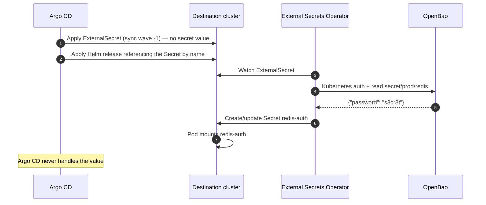

# Way 1 — Destination Cluster Secret Management with External Secrets Operator

This is the default path. Git holds only a reference; the secret value travels
OpenBao → ESO → Kubernetes `Secret` → Pod, and Argo CD never sees it.

Applies to any chart exposing an `existingSecret` / `*Secret` parameter, which is the large
majority of maintained charts.

## Flow



## Why the injector and CSI driver cannot replace this everywhere

All three are destination-cluster mechanisms and all three are fine for application
workloads, but they differ in *what they produce*:

| Mechanism | Produces | Chart can reference by name? | Works for Argo CD's own secrets? |
|---|---|---|---|
| External Secrets Operator | A real `Secret` object | Yes | **Yes** |
| Vault Agent Injector | Files inside the pod | No | No |
| Secrets Store CSI Driver | A mounted volume (optionally a synced `Secret`) | Only with `secretObjects` | No |

`existingSecret` parameters need a `Secret` **object**, so ESO is the natural fit. Injector
and CSI remain valid for apps that read secrets from a file path.

## Implementation

### 1. Secret store

One `ClusterSecretStore` serves all namespaces —
[`examples/redis-eso/clustersecretstore.yaml`](../examples/redis-eso/clustersecretstore.yaml).
OpenBao is API-compatible with Vault, so ESO's `vault` provider works unchanged:

```yaml
provider:
  vault:
    server: https://openbao.openbao.svc.cluster.local:8200
    path: secret
    version: v2
    auth:
      kubernetes:
        mountPath: kubernetes
        role: external-secrets
        serviceAccountRef:
          name: external-secrets
          namespace: external-secrets
```

Note `path: secret` and `version: v2`: ESO adds the `data/` segment itself, so `remoteRef.key`
is written **without** it — the opposite of the AVP placeholder syntax.

### 2. ExternalSecret

```yaml
spec:
  refreshInterval: 1h
  secretStoreRef:
    name: openbao-backend
    kind: ClusterSecretStore
  target:
    name: redis-auth
    creationPolicy: Owner
  data:
    - secretKey: redis-password
      remoteRef:
        key: secret/prod/redis   # no "data/" here
        property: password
```

### 3. Chart values

```yaml
auth:
  enabled: true
  existingSecret: redis-auth
  existingSecretPasswordKey: redis-password
```

For Redis ACL users, the usernames stay in `values.yaml` (they are not secret) and the
passwords live in a Secret whose **keys are the usernames**:

```yaml
auth:
  acl:
    users:
      - username: "my-user"
        enabled: "on"
        commands: "+@all"
        keys: "~*"
        channels: "&*"
    userSecret: redis-acl-users
```

## Two operational details

**Ordering.** The `Secret` must exist before the workload starts. Annotate the
`ExternalSecret` with `argocd.argoproj.io/sync-wave: "-1"`. Argo CD ships a built-in health
check for `ExternalSecret`, so it waits until ESO has actually populated the Secret before
proceeding to wave 0. Without the wave the pod simply crash-loops briefly.

**Rotation does not restart pods.** ESO updates the `Secret` at `refreshInterval`, but a
running pod keeps the old value; nothing in Git changed, so Argo CD sees no drift. Use
[Reloader](https://github.com/stakater/Reloader):

```yaml
metadata:
  annotations:
    reloader.stakater.com/auto: "true"
```

**Orphaned resources.** The generated `Secret` exists in the cluster but not in Git. With
`creationPolicy: Owner` it is owned by the `ExternalSecret`, so it is garbage-collected
correctly, but Argo CD's orphaned-resource monitoring may still list it. Exclude it at the
project level if the noise is unwanted:

```yaml
spec:
  orphanedResources:
    ignore:
      - kind: Secret
```

## Escape hatches before resorting to Way 2

When a chart appears to have no `existingSecret` parameter:

1. **`usePasswordFiles`** or similar — some charts read a mounted file instead of a value.
2. **Kustomize post-renderer patch** — replace the rendered literal with a `secretKeyRef`.
   This keeps Argo CD out of the secret path entirely and is the strongest option for
   stubborn charts:

   ```yaml
   - op: replace
     path: /spec/template/spec/containers/0/env/0
     value:
       name: DB_PASSWORD
       valueFrom:
         secretKeyRef:
           name: db-credentials
           key: password
   ```

3. **Wrapper chart** — declare the upstream chart as a dependency, add your own Secret
   template, and send a PR upstream to add `existingSecret` support.

Only after all three fail is [Way 2](02-manifest-generation-openbao.md) justified.
